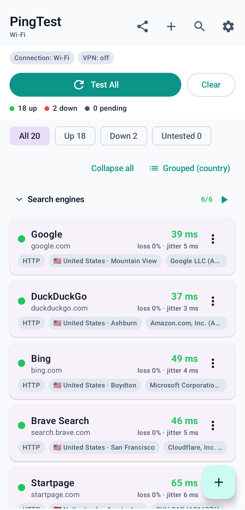
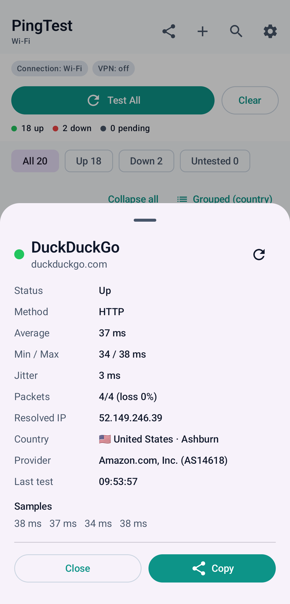
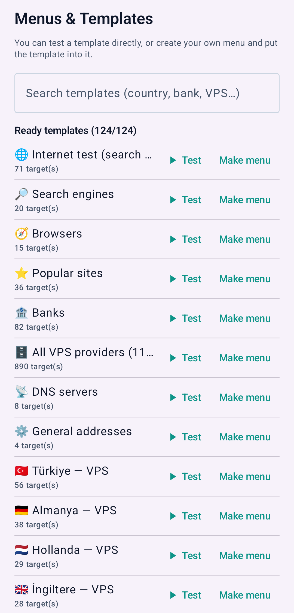
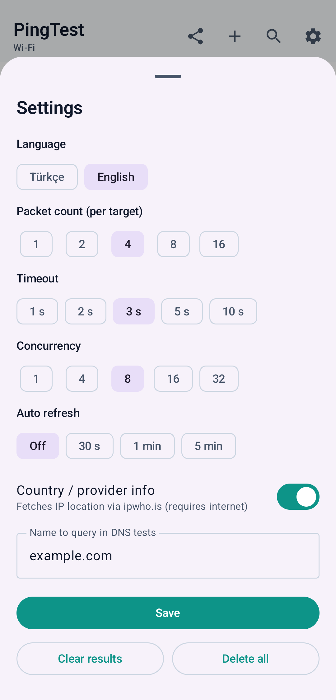

# PingTest

**A root-free Android app to test which IPs, DNS servers and websites are actually
reachable from your connection — and how fast they respond.**

Add targets, hit *Test All*, and instantly see which ones work, where they are
located, and how many milliseconds they take. Ideal for exploring VPN/VPS
endpoints, checking which DNS resolvers are alive, or just seeing what is
reachable from your mobile network.

[](https://pingtest.glitchidea.com/)
[](https://github.com/glitchidea/PingTest/actions/workflows/android-ci.yml)
[](https://developer.android.com)
[](https://kotlinlang.org)
[](https://developer.android.com/jetpack/compose)
[](https://github.com/glitchidea/PingTest)
[](LICENSE)

<p align="center">
  
  
  
</p>

## Features

- **Five test methods** — TCP handshake, ICMP ping, DNS query and HTTP(S) HEAD,
  plus an **Auto** mode that tries them in order and picks the first one that works.
- **No root required.** Everything runs with normal app permissions.
- **Ready-made presets** you can test in one tap:
  - 🌐 Internet test — search engines, browsers and popular sites (~70)
  - 🗄️ VPS providers — per-country menus (116 countries, ~700 providers)
  - 📡 DNS servers · ⚙️ Common addresses
- **🌍 Country list** (~730 targets, 246 countries) — two local DNS servers plus the
  ccTLD authoritative server for each country, bundled in the app.
- **Menus & templates** — test a preset directly, or bundle presets into your own
  reusable menus.
- **Bulk import** — paste one address per line (`ip`, `ip:port`, `dns://…`,
  `tcp://…`, `icmp://…`, `https://…`, `host , label`).
- **Grouped, collapsible list** with per-group counters and one-tap group testing.
- **Live counters** — xx working · xx down · xx pending, plus per-filter counts.
- **Country flag, country/city and ISP/ASN** for each target (via `ipwho.is`).
- **Filter** (all / up / down / untested), **search** and **sort**
  (latency / name / country / status).
- **Wi-Fi / Mobile / VPN indicator** so you always know what path the traffic takes.
- **Background testing** via a foreground service — start a run, turn off the
  screen, and progress keeps showing in the notification.
- **Persistent results** — results survive app restarts; nothing is lost.
- **Auto-refresh** (off / 30 s / 1 min / 5 min) and **share/export** results as text.
- **🌍 Multi-language UI — Turkish & English**, switchable instantly in Settings.

## Test methods

| Method | What it does | Root | Notes |
|--------|--------------|------|-------|
| **TCP** | Opens a TCP handshake to `ip:port` and measures RTT | No | Most reliable; works almost everywhere |
| **Ping (ICMP)** | ICMP echo via `/system/bin/ping` | No | Some devices/versions block it → returns "Unsupported" |
| **DNS** | Sends a real DNS query (UDP 53) and times the answer | No | Great for discovering DNS/VPN resolvers |
| **HTTP** | HTTPS/HTTP `HEAD` request for real-world latency | No | Some servers reject HEAD, but the response is still measured |
| **Auto** | TCP(443) → TCP(80) → Ping → (if IP) DNS | No | First working method wins |

Each test is repeated *packet count* times, then **min / average / max / jitter**
and **packet loss %** are computed.

## Screenshots

| Home | Result detail |
|------|---------------|
|  |  |

| Menus & templates | Settings |
|-------------------|----------|
|  |  |

## Download & install

The easiest way is the website — **[pingtest.glitchidea.com](https://pingtest.glitchidea.com/)**.
The download button there always points to the newest APK; you don't have to dig
around GitHub. You can also grab it from the
**[Releases](https://github.com/glitchidea/PingTest/releases)** page. Install the
APK on your device (you may need to allow installing from unknown sources). The app
is not published on Google Play.

## Build from source

Requirements: **JDK 17+** and the **Android SDK** (compileSdk 36).

```bash
git clone https://github.com/glitchidea/PingTest.git
cd PingTest

export ANDROID_HOME=/path/to/android-sdk
export JAVA_HOME=/path/to/jdk

./gradlew assembleDebug
# APK: app/build/outputs/apk/debug/app-debug.apk
```

Install to a connected device:

```bash
adb install -r app/build/outputs/apk/debug/app-debug.apk
```

Versioned build (override the version name/code):

```bash
./gradlew assembleDebug -PversionNameOverride=1.0.0.1 -PversionCodeOverride=2
```

## Usage tips

- **Discovering VPN servers:** paste server IPs as `ip:port`, pick the **TCP**
  method (usually 443/1194/8388) and hit *Test All*.
- **Discovering DNS resolvers:** add lines like `dns://1.1.1.1`; the method is set
  to DNS automatically.
- Sort by **Latency** to surface the fastest targets.
- Use the **Up** filter to hide unreachable targets.

### Import formats

```
8.8.8.8
1.2.3.4:443
1.1.1.1 , Cloudflare          # with a label
dns://9.9.9.9
dns://1.1.1.1?example.com     # DNS query name
tcp://vpn.example.com:1194
icmp://1.2.3.4
https://example.com
```

## Menus & templates

**Menus & templates** (the **+** button) is the app's "add" hub:

| Template | Contents |
|----------|----------|
| 🌐 Internet test | search engines + browsers + popular sites (~70) |
| 🔎 Search engines | Google, Yandex, DuckDuckGo, Bing, Brave, Baidu, Qwant, Kagi… |
| 🧭 Browsers | Firefox, Chrome, Edge, Opera, Vivaldi, Brave, Arc, Tor… |
| ⭐ Popular sites | YouTube, Wikipedia, GitHub, Reddit, X, Instagram, TikTok, Netflix, Trendyol… |
| 📡 DNS servers | Cloudflare, Google, Quad9, AdGuard… |
| ⚙️ Common addresses | widely reachable, high-availability addresses |

Each template row has two actions: **▶ Test** (add & test now) and **Make menu**
(create your own menu containing the template). Menus are fully modular — templates
are ready-made building blocks, menus are containers you place them in.

## Country list (~730 targets)

The **"Load all countries (~730)"** action adds, for every country:

- **2 local public DNS servers** (IPs actually located in that country)
- **1 ccTLD authoritative server** (the country's domain name server — an almost
  always-alive fallback, marked with `?zone` in `assets/countries.txt`)

246 countries/regions are covered. Recommended settings for the big list:
packet count **2**, timeout **2 s**, concurrency **16**.

> The list is generated from the public `public-dns.info` dataset; some entries may
> be stale. That is exactly the point: find out which ones work **from your
> connection**.

## VPN note

PingTest measures reachability using your **mobile internet**. When a VPN is **on**,
all traffic goes through the tunnel, so the measured latency is the latency of the
**path to the VPN server**, not the target's real latency. The app shows
**"VPN: ON"** at the top and warns you. This lets you compare, for example, which
IPs are directly reachable with the VPN off vs. which the tunnel can reach with it on.

## Languages

PingTest speaks **Turkish** and **English**. Switch languages any time in
**Settings → Language** — the change applies instantly (no restart) and is
remembered the next time you open the app. Every screen, status label, counter,
background notification and the exported report follow the selected language.

## Permissions

- `INTERNET` — tests and country/ISP lookups
- `ACCESS_NETWORK_STATE` — read Wi-Fi / Mobile / VPN state
- `FOREGROUND_SERVICE` / `FOREGROUND_SERVICE_DATA_SYNC` — keep testing while the screen is off
- `POST_NOTIFICATIONS` — background progress notification (Android 13+)

No other permissions and **no root**.

## Contributing

Issues and pull requests are welcome. If you plan a larger change, please open an
issue first so we can align on the approach. By participating you agree to keep
discussions respectful and constructive.

## License

Released under the **MIT License** — see [LICENSE](LICENSE).

## Disclaimer

PingTest is intended for testing connectivity to services **you are allowed to
probe**. Only test hosts and networks you own or are authorized to test.
